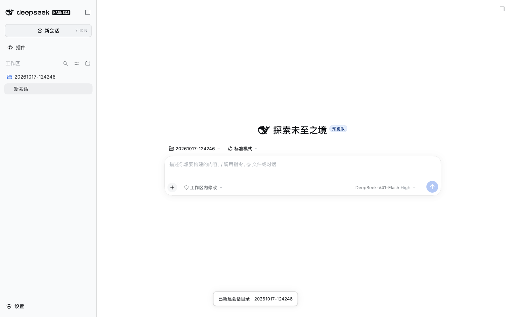
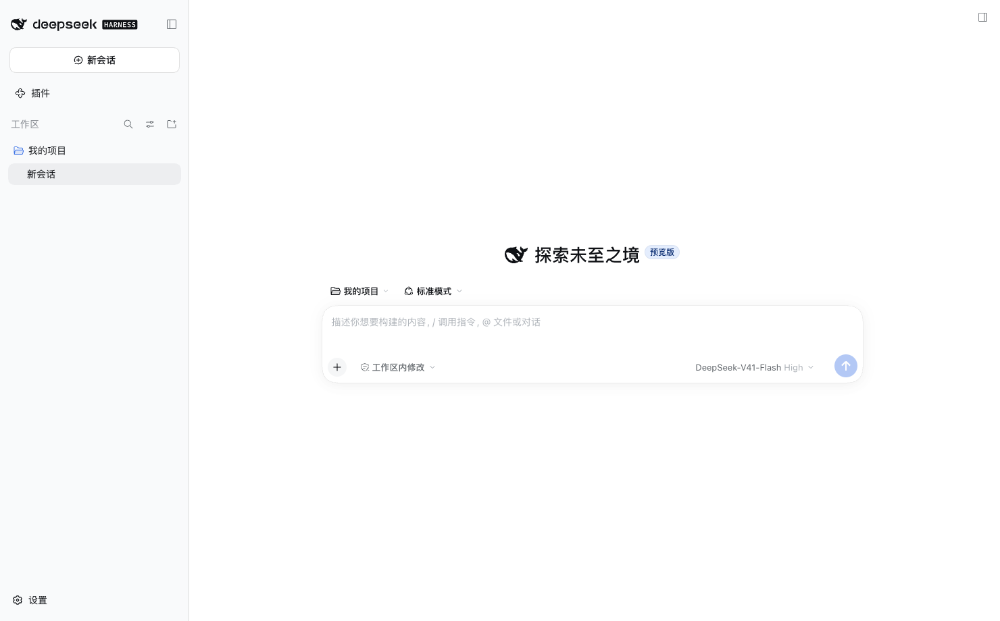
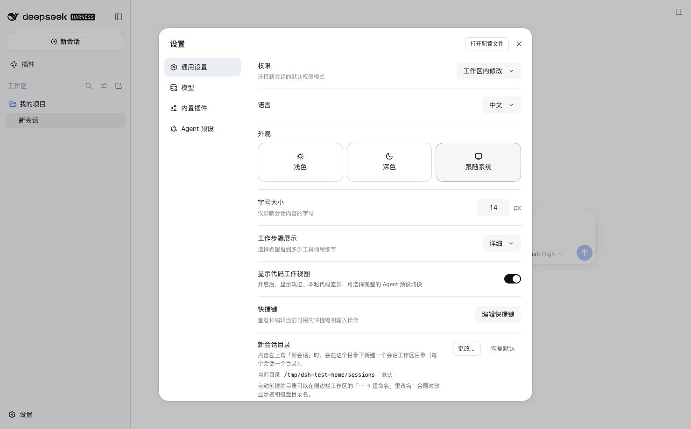

# dsh-plugin-folder-sessions

[](https://github.com/kgw1/dsh-plugin-folder-sessions/actions/workflows/ci.yml)

A [DSH](https://github.com/deepseek-ai/deepseek-harness) Desktop plugin that makes
**New Session** mean *"a brand-new folder for this session"* instead of *"reuse an
existing workspace"* — while keeping the workspace **+** button exactly as DSH ships it.



- **New Session** (sidebar button, top-left header button, `Cmd+N`) creates
  `<root>/YYYYMMDD-HHmmss` under a configurable root, registers it as a workspace,
  and opens a session whose cwd is that folder.
- **Workspace “+” bubble** keeps stock behavior: create (or reuse a blank) session
  **inside that workspace**. Scheduling / agent-preset internals that also call the
  same service are untouched.
- **Settings → General → New session folder**: view/change the root with the native
  directory picker, or restore the default (`~/dsh-sessions`).
- **Renaming an auto-created workspace** (`⋯ → Rename`) renames the on-disk folder
  *and* the display name. Non-managed workspaces still get the stock title-only rename.

| Rename workspace = rename folder | Settings row |
|---|---|
|  |  |

## Compatibility

- Target runtime: **DSH Desktop 0.2.0-rc.2** (`hostProtocolVersion` 4).
  Declared peer range: `@deepseek-ai/dsh >=0.2.0-rc.2 <0.3.0`.
- Hosted-web / desktop web surface. The plugin ships both halves:
  - Host half (`index.js`, `host/`): zero bare imports, four same-origin HTTP routes.
  - Client half (`client.js`): hand-written `window.__ModuleLoader__` bundle that only
    requires the `react` platform seed — no bundled framework, no second runtime.
- Verified end-to-end against the real 0.2.0-rc.2 runtime in an isolated `DSH_HOME`
  (Playwright + headless Edge): see [docs/evidence](docs/evidence/README.md).

## Install

### Through DSH (recommended)

DSH Desktop → **Plugins** page → install by one of:

| Channel | What to enter |
|---|---|
| npm (after publishing) | `dsh-plugin-folder-sessions` or `dsh-plugin-folder-sessions@0.1.0` |
| GitHub | `github:kgw1/dsh-plugin-folder-sessions#v0.1.0` (tag must contain prebuilt `client.js`) |
| Local tarball | absolute path to `dsh-plugin-folder-sessions-0.1.0.tgz` |

The plugin manager runs pnpm in the profile, selects the bundle, and applies its
patch. **Fully quit and reopen DSH** afterwards (the desktop profile reads its patch
layer at process start). Uninstall from the same page; removing the bundle leaves
your config and session folders untouched.

### Development / local-path install (repo checkout only)

```sh
git clone https://github.com/kgw1/dsh-plugin-folder-sessions.git && cd dsh-plugin-folder-sessions
node scripts/build-client.mjs   # rebuild client.js after editing src/client
node scripts/deploy.mjs         # backup + append an absolute-path entry to ~/.dsh/profiles/desktop/cordis.patch.yml
# fully quit and reopen DSH, then:
node scripts/verify.mjs         # HTTP smoke test against http://127.0.0.1:19387
```

`node scripts/deploy.mjs` is a developer convenience only; published installs should
go through the DSH plugin page.

> **Migrating from the dev install:** if the profile patch already contains the
> absolute-path entry written by `scripts/deploy.mjs` (entry id `folder-sessions`),
> remove that `- insert:` block before selecting the bundle in the Plugins page —
> otherwise both the path row and the bundle row compose two entries with the same
> id. The dev entry is recognizable by its `name: '/absolute/path/index.js'`.

## Configuration

Settings → General → **New session folder** → *Change…*, or edit
`$DSH_HOME/folder-sessions.json` (default `~/.dsh/folder-sessions.json`):

```json
{
  "version": 1,
  "baseDir": "/Users/you/dsh-sessions",
  "knownRoots": ["/Users/you/dsh-sessions"]
}
```

- `baseDir` — where new per-session folders are created. Missing directories are
  created recursively; `~/` is expanded.
- `knownRoots` — every root this plugin has managed. Kept so workspaces created under
  an older root remain renamable after you switch roots.
- The profile `config.baseDir` on the installed bundle row is used as the initial
  value when the JSON file is absent.

## Behavior notes

### New Session flow

1. `POST /folder-sessions/api/directories` → host creates a unique folder under the
   root (`YYYYMMDD-HHmmss`, `-2`/`-3` on collision).
2. Client calls the public workspaces service: `create({ path })`, then
   `openWorkspace(id)` → DSH creates the session with that cwd and navigates to it.

Failures are surfaced with a toast. If the host routes are missing (plugin half not
loaded), the click silently falls back to stock DSH behavior.

### Rename flow (why it touches the registry)

DSH 0.2.0-rc.2 has no public "update workspace path" API, and a session's cwd is
written into its header at creation. The plugin therefore:

1. renames the real directory;
2. leaves a **compatibility symlink** at the old path so already-created sessions
   keep resolving their cwd (renaming again updates the chain);
3. updates `workspaceRegistry`'s session-path index and record (`path` + `title`).
   Clients receive the normal workspace `upsert` frame, so the sidebar title updates.

All registry internals are probed before use; on a runtime where they changed, the
plugin degrades to title-only rename instead of touching the disk. Do not delete the
compatibility symlink while old sessions may still be reopened.

## HTTP API (host half)

All routes are exact matches under `/folder-sessions/api` and are served before the
browser-auth fallback (same-origin `fetch` from the GUI needs no token):

| Method | Path | Body | Purpose |
|---|---|---|---|
| GET | `/config` | — | current root / default / config path |
| POST | `/config` | `{ baseDir }` | validate + create + persist root |
| POST | `/directories` | `{ name? }` | create a unique session folder |
| POST | `/rename` | `{ workspaceId, title }` | rename managed folder + title |
| GET | `/health` | — | plugin/version/routes/registry diagnostics |

## Development

```sh
npm run build      # regenerate client.js from src/client/index.js (id read from package.json)
npm test           # 64 node:test cases (host config/dirs/HTTP + client logic + bundle contract)
npm run check      # build + syntax checks
npm run pack:local # npm pack into dist/
```

Layout:

```
index.js                  host plugin entry (name / inject / apply; zero bare imports)
host/config.js            config file (atomic writes, defaults, ~ expansion)
host/dirs.js              session-dir creation; directory rename + registry sync/fallback
host/http.js              named routes, JSON handling, fail-soft mounting
src/client/index.js       browser half source (ESM, unit-testable)
client.js                 generated __ModuleLoader__ bundle (committed)
scripts/build-client.mjs  bundle builder
scripts/deploy.mjs        dev-only absolute-path profile install
scripts/verify.mjs        post-restart HTTP health probe
tests/                    node --test suite
docs/evidence/            real-runtime E2E screenshots
```

## Publishing

Requires an npm account and package ownership of the name:

```sh
npm run check && npm test
npm publish --access public
# GitHub channel: git tag v0.1.0 && git push --tags (tag must contain built client.js)
```

The package declares `dsh.bundle.patch`, so the DSH plugin manager treats it as an
installable bundle and picks it into `dsh.profile.bundles` automatically.

## 中文说明

DSH Desktop 插件：把左上角「新会话」从“复用已有工作区”改成“在指定根目录下新建一个会话
目录并在其中开新会话”；工作区行右侧的「+」气泡保持原生行为。

- 安装：DSH 侧边栏 **插件** 页面 → 输入 npm 包名 / GitHub 地址 / 本地 tgz 绝对路径；
  安装后**完全退出并重开 DSH**。
- 配置：设置 → 通用 → 「新会话目录」，默认 `~/dsh-sessions`。
- 改名：自动创建的工作区用 `⋯ → 重命名` 会同时改显示名与磁盘文件夹名；旧路径保留
  兼容软链接，已创建的会话仍可用。
- 卸载：插件页移除即可，配置与会话目录保留。

## License

MIT. See [LICENSE](LICENSE).
